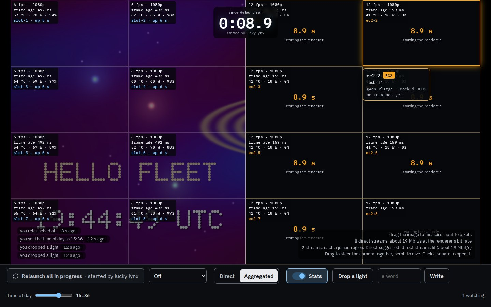

# fleet/web: the GPU wall page

The page for `docs/fleet/ARCHITECTURE.md`: one image tiled across every GPU, fcvm on the
left half and EC2 on the right, live from each tile's own renderer, with the
relaunch-all race, the shared camera, viewers' words and lights, a stats switch and a
shared auto-relaunch setting. It runs against a mock fleet (`mock/`) until the
coordinator and renderers are deployed.


| | |
|---|---|
|  |  |
|  |  |
|  | |


## Layout

```
core/      the rules, pure TypeScript: no DOM, no clock, no randomness, no I/O
           (lint and a tsconfig with no DOM types enforce it). Protocol parsing, the
           reducer, pending intents, clock sync, layout, the common-t choice, view
           models and every visible string.
app/       Next.js (App Router). Draws view models and sends actions:
           _wall/Wall.tsx           the page, input handling
           _wall/frames.worker.ts   frame sockets, WebCodecs decoders, one OffscreenCanvas
           _wall/wall-client.ts     the coordinator socket and the store
           wall.css                 the surface's own stylesheet (no component library)
mock/      a mock coordinator and mock renderers, Node only
e2e/       Playwright tests against the mock (Chromium; a tagged subset in WebKit)
scripts/   dev-mock.ts (run the page on the mock), measure.ts (decode and draw cost)
```

## Running it

Ports come from the environment or a gitignored `.env.ports`; nothing uses a framework
default. On a machine with the port registry, claim a block first
(`ports claim fcvm-fleet-web "$PWD"`) and write it down:

```
FLEET_WEB_PORT=<block+0>
FLEET_MOCK_COORD_PORT=<block+1>
FLEET_MOCK_RENDER_PORT=<block+2>
FLEET_TEST_BASE_PORT=<block+10>      # tests use it and the next two
FLEET_MEASURE_BASE_PORT=<block+15>   # measure.ts uses it and the next two
```

```
pnpm install
pnpm dev:mock         # the page on the mock fleet, next dev
pnpm build && pnpm start:mock    # the same with a production build
pnpm lint && pnpm typecheck && pnpm test     # 102 unit tests (vitest)
pnpm build && pnpm test:e2e                  # 26 browser tests (Playwright)
FLEET_SCREENSHOT_DIR=$PWD/docs/screenshots pnpm test:e2e   # also rewrites the pictures
pnpm build && pnpm measure [16 50 100]       # decode and draw cost
```

On a small machine, `FLEET_E2E_VIEW=1024x640 FLEET_MOCK_FPS=10 FLEET_MOCK_THREADS=3`
makes the mock's work fit (CI uses these on a 4-vCPU runner). The mock needs `ffmpeg` with libx264 (`FLEET_FFMPEG` names another binary; CI uses the one in the `ffmpeg-static` package). Its knobs (`FLEET_MOCK_TILES`, `FLEET_MOCK_FCVM_MS`,
`FLEET_MOCK_EC2_MS`, `FLEET_MOCK_FPS`, ...) are listed at the top of `mock/main.ts`.
In production the page reads the coordinator's URL from `FLEET_COORD_URL` per request.

## How the page works

**Two ways to receive the image.** Each viewer picks Direct (one stream per tile, from
its VM) or Aggregated (a few streams, each an aggregator's joined region, drawn as one big
tile with crop and x0/y0 as usual) with the Streams switch. Until the viewer picks, the
page follows its suggestion: Aggregated when the fleet has aggregators and either the
browser reports a downlink under what Direct needs at the renderer's rate, or more than
10% of tiles ran behind the common t over the last ten seconds of Direct; otherwise
Direct. A pick is remembered in this browser. Tile state (dark tiles, outlines in the
half's colour, phases, clocks, hover outlines and labels) comes from the snapshot and is
drawn the same way in both modes: in Aggregated mode a relaunching tile's region is
painted dark over the aggregator's pixels.

**Switching never hitches.** The page keeps the shown mode's streams and opens the other
mode's in the background. While it waits, the drawn t does not advance past the newest
frame every incoming region holds (an aggregator joins tiles before it encodes, so it runs
a little behind), and never goes back. Once every incoming region holds a decoded frame at
one t no older than the one on screen, the next draw shows the new mode whole, and the old
streams close after it. After 4 s of waiting the image stops holding back for it and keeps
playing the old mode. A test records every draw across a switch both ways and fails on any
region drawn without a frame or any t going back.

**Two kinds of connection.** One WebSocket to the coordinator's `/live` for snapshots,
receipts and clock answers, and one per tile to its renderer for frames. The frame
sockets, decoders and the canvas live in a worker, so the React thread never sits
between a frame and the screen.

**Shared state.** Every intent carries a client UUID and is shown at once as pending
(a relaunched tile goes dark for its viewer before the coordinator answers, a setting
shows its new value). It stays pending until its receipt has arrived and a snapshot at
the receipt's version has been accepted, so the overlay never flickers back. Snapshots
older than the last accepted version are dropped. After a reconnect the page sends the
intents that have no receipt again, with the same ids; the coordinator applies an id
once and answers a repeat with the first receipt.

**Clock.** Pings go out five times quickly, then every 2 s. The offset comes from the
sample with the smallest round trip of the last eight. Race clocks, dark-tile clocks,
the auto-relaunch countdown and frame age all use the coordinator's time.

**One common t.** Each tile keeps up to six decoded frames. Every draw picks T, the
frame time held by the most keeping-up tiles (the latest, on a tie), and draws each
tile's frame at exactly T. A tile more than 0.35 s behind the newest, or whose frames the
others no longer hold, is drawn dimmed from its newest frame before T; a tile that just
joined stays dark until the image reaches its first frame; T never goes back. A decoder
holding more than eight undecoded chunks drops input until the next keyframe. Two different times are never drawn side by
side undimmed. Draws happen only when T or the plan changes, so the canvas redraws at
the renderers' rate, not the display's.

**Layout.** The image keeps the coordinator's `image_aspect` and is fitted inside the
space the page has. Tile edges are snapped to device pixels from the image's own edges,
so neighbours share an edge exactly. Each tile asks its renderer for the height it
occupies in device pixels, rounded up to one of 72, 90, 108, 144, 180, 216, 270, 360,
432, 540, 720 or 1080.

**Seams on demand.** With the pointer over the image every tile boundary fades in as a
1-device-pixel line at 25% white, and the tile under the pointer gets an outline in its
half's colour and a label (slot, kind, GPU, host, last relaunch). A long press does the
same on a touch screen; keyboard users tab into a grid of the tiles and move with the
arrow keys. All of it is drawn by the page over the frames, never in them.

**An opened tile** is drawn into a larger box with the tile's own aspect, and only its
renderer is asked for a taller stream (`{"h": ...}` on the open socket). The page
accepts either a new text header or a keyframe of the new size after a height change.

## Measurements

Decode and draw cost in Playwright's headless Chromium 156 on this development machine
(a 96-core Arm Neoverse-V2 server with no GPU, so decoding and canvas drawing are both
software). The mock renderers ran on the same machine. These numbers are indicative
only: a laptop or phone decodes in hardware and composites on its GPU. Mock streams are
30 frames per second, on the renderer's t = k/30 grid.

| tiles | viewport | stream height | decoded frames/s (of 30 x tiles) | draw per frame, p50 / p95 | display frame, p50 / p95 | incoming (mock) | at the renderer's rate | browser CPU | CPU per decoded frame |
|---|---|---|---|---|---|---|---|---|---|
| 16 | 1440x900 | 216 | 478 of 480 | 5.9 / 8.0 ms | 16.7 / 16.8 ms | 6.4 Mbit/s | 37.6 Mbit/s | 0.46 cores | 0.97 ms |
| 50 | 1440x900 | 180 | 1500 of 1500 | 7.8 / 8.3 ms | 16.7 / 16.8 ms | 9.1 Mbit/s | 46.6 Mbit/s | 0.75 cores | 0.50 ms |
| 100 | 1440x900 | 90 | 3001 of 3000 | 10.3 / 12.6 ms | 16.7 / 17.6 ms | 11.2 Mbit/s | 60.0 Mbit/s | 1.12 cores | 0.37 ms |
| 16 | 2560x1440 | 360 (cut by the budget) | 459 of 480 | 22.4 / 23.5 ms | 16.7 / 24.0 ms | 11.2 Mbit/s | 80.0 Mbit/s | 0.66 cores | 1.44 ms |
| 100 | 2560x1440 | 144 | 2943 of 3000 | 19.5 / 21.6 ms | 22.9 / 31.6 ms | 14.2 Mbit/s | 79.7 Mbit/s | 1.48 cores | 0.50 ms |

Command: `FLEET_MOCK_THREADS=40 node scripts/measure.ts 16 50 100` (8 s warm-up, 15 s
measured) and `FLEET_MEASURE_VIEW=2560x1440 FLEET_MOCK_THREADS=60 node scripts/measure.ts
16 100`, with the machine's load average at 9 to 13 from other work. "Incoming (mock)" is
what the page received from the mock's libx264 at constant quality; "at the renderer's
rate" is what the same streams cost from the real renderer, which encodes at a constant
0.8 bits per delivered pixel (overlap included) at 30 fps, at least 0.6 Mbit/s each
(`core/bandwidth.ts`). At 1440x900 every run held all tiles at one t with none behind,
and decode latency stayed under 3.5 ms at p95. Draw time follows the pixels drawn, about
5 ms per million in this software canvas, more than the number of tiles. At 2560x1440 a
draw takes longer than a 60 Hz frame and the page decoded 98% of the frames sent: this
software canvas is the limit there (in the 16-tile run the mock also fell behind on its
360p frames). On this evidence 100 tiles fit one browser's decoding budget; the
measurement in `docs/fleet/ARCHITECTURE.md` (a laptop and a phone, with GPU compositing,
Chrome and Safari) should set `max_tiles`.

**Bandwidth.** Each tile asks for the device pixels it covers, rounded up to the next of
the twelve heights. In Direct mode the page then keeps the streams within 80 Mbit/s at the
renderer's rate: while the sum is over, the smallest tile still at the default quality
asks for `q=lo` (small tiles lose least on screen), and once every tile is at `lo` the
tallest stream steps down one height. `?budget=<Mbit/s>` sets another budget for trying it.
The page models `lo` as half the default rate and floor, and `hi` as double; the renderer
has not documented its figures yet. With a tile
opened, every other tile keeps streaming at the smallest height (72) so closing it is
instant, and only the opened tile asks for its full size. The floor of 0.6 Mbit/s a
stream sets the cost of a large wall: 100 tiles cost 60 Mbit/s at any height, so a
fleet that wants 100 tiles on ordinary connections needs a lower floor or fewer tiles
per viewer. The stats switch shows the current total.

**Safari.** According to WebKit's release notes, WebCodecs `VideoDecoder` shipped in Safari 16.4 (macOS and iOS), with H.264
among its codecs, as did `OffscreenCanvas` with a 2D context. Playwright's WebKit build
(WebKit 27.2 on Linux, not Apple's Safari) reports H.264 decoding supported, and it runs
the mosaic, seam and hover tests here (the `@engines` tests). If a worker has no
`requestAnimationFrame`, the page ticks it from the main thread. Apple's Safari itself is
not tested by this PR.

## Interface notes

The page and the mock follow `fleet/PROTOCOL.md` as the coordinator PR (#1146,
"Coordinator") and the renderer PR (#1144, "Renderer") write it: tiles are places
(`fcvm:3`) with their slot (`slot-3`) beside them, the snapshot carries `image_aspect`,
`gpu` is `{sbdf, name}` with readings in `gpu_stats`, timings are `<part>_ms`, receipts
are `committed` or `refused`, the clock answer echoes `client_unix_ms`, `{"type":
"error"}` exists, snapshots may skip versions, frames fall on `t = k/30`, the stream
header carries `full_width`, `full_height`, `x0`, `y0` and `fps`, the stream may be
larger than asked (the encoder's 146 x 50 minimum) and the page scales it into the
tile, `{"h": N}` brings a new header and a keyframe, and a stream carries a margin
around its rectangle with `crop: {left, top, right, bottom}` in its header (zeros when
absent) so separately encoded tiles meet without an H.264 edge. The page draws only
the inner rectangle: it draws the whole frame scaled so the inner rectangle covers the
tile's box, clipped to the box, because WebKit ignores a VideoFrame's source rectangle
and `visibleRect` when drawing. In the mosaic the inner rectangle is placed at `x0, y0` of
`full_width x full_height`; an opened tile fills its box. The mock delivers exactly the
renderer's overlap (up to 16 px inside the image, one side a pixel short to keep sizes
even). The
page never reads `/health` (so not `slots_missed`) and never sets the scene's `budget`. The brief's older shapes
(`fleet.hosts` as a number, `waiting_for_capacity`, `applied`) are still read.

What the page does where the protocol leaves a choice:

- **Camera drag** sends `{"drag": {"yaw_deg", "pitch_deg", "dive"}}`: a drag across
  the whole image width is 90 degrees of yaw (negative when dragging right: the drag
  grabs the world), down the height 50 degrees of pitch, and a wheel notch one unit
  of dive. The sign convention should be agreed with the coordinator.
- **A dropped light** is sent as `{"pos": [x, altitude, z], "color": [r, g, b]}`: the
  page takes the camera at the drawn t from the snapshot's keys (linear between keys;
  the renderer's Catmull-Rom spline differs only while the camera moves) and places
  the light 2 km along the ray through the clicked pixel.
- **Input-to-pixel latency** runs from the drag to the first draw at or past the camera
  key tagged with that intent. For a coordinator that sends untagged keys the page falls
  back to the first key newer than any it held when it sent the intent.
- **In the mosaic** each stream's inner rectangle is placed at `x0, y0` of `full_width x
  full_height`; an opened tile fills its box.

From the coordinator's next round (#1146), which the page follows and the mock speaks:
`time_of_day` is a fraction of the day, `image_aspect` defaults to 16/9, words are up to
28 characters, camera keys carry the `intent` that made them (input-to-pixel latency is
then exact), actions carry `args` and the actor's viewer id, and each connection is told
its own viewer id, so the page says "you". Until that document lands the page assumes
these shapes: the id arrives as `{"type": "welcome", "viewer": "<id>"}` (or as `you` on a
snapshot message, never inside `state`, which every viewer shares), an action's actor is
`viewer` (or `actor`), and the snapshot lists `aggregators: [{id, frame_url, rect}]`. The
renderer's `q=hi|std|lo` goes on the frame URL; the page sends `q` only when it is not
`std`.

Still open:

- `actions` from the coordinator in this round do not carry arguments yet, so until they
  do the ticker words what it can from the summary.

The mock encodes H.264 baseline with libx264 (`q` as constant quality 14, 18 or 26)
rather than High with NVENC, runs one aggregator per band of about eight fcvm tiles and
one for the EC2 half (each draws its region whole and blacks out tiles that are not
running), draws the UTC clock once in each half, reports EC2
phases `launching` and `starting` with `launch_ms` and `ready_ms` as the coordinator's
EC2 driver does, and shows `relaunching` for 150 ms before a tile's first reported
phase.

## Not done here

- Deploying: the Cloudflare Workers build (OpenNext) and the staging Worker behind Access.
  The client bundle uses no Node APIs; the server page reads one environment variable.
- Running against the real coordinator and renderers, and the interface decisions above.
- The `max_tiles` measurement on a laptop and a phone in Chrome and Safari.
