# fleet/web: the GPU wall page

The page for `docs/fleet/ARCHITECTURE.md`: one image tiled across every GPU, fcvm on the
left and EC2 on the right, each side as wide as the GPUs it has live, live from each tile's own renderer. The render is the
page: the image fills the screen (contain-fit, centred), with a row of controls over its top and a strip over its
bottom (the one button, "Restart all N GPUs", the last race in one line, the next scheduled restart, and what draws the
image: resolution, GPUs, frame rate). The controls fade when the pointer rests. A race is drawn on the picture: every
dark tile counts, each half has one large clock (fcvm freezes when its last tile is back, EC2 keeps counting), each tile
shows its own time as it relights, and a card gives the result for 8 s before the strip's line takes it over. Each tile asks its renderer for at most `MAX_TILE_PX` (0.5 M)
pixels, so one viewer on a large screen cannot push a GPU under one sample per pixel. Everything else
(the camera's next stop, words, lights, how the streams arrive, stream stats, the counters and recent actions) is in the drawer, where the sender of a word also picks how it is drawn:
Lockup (type above the clock), Skywriting (smoke in the sky) or Landmark (big letters
standing on a ridge). The three thumbnails are crops of the renderer's
`shots/text-styles.jpg` (#1178, commit 46feb782), in `public/text-styles/`. A viewer can also borrow one of the wall's GPUs for a
minute; its camera flies the coordinator's autopilot loop from the first frame until the
viewer pauses it (the Pause button or Space) or drags, scrolls or presses a camera key. It runs against a mock fleet (`mock/`) until the coordinator and renderers are
deployed.

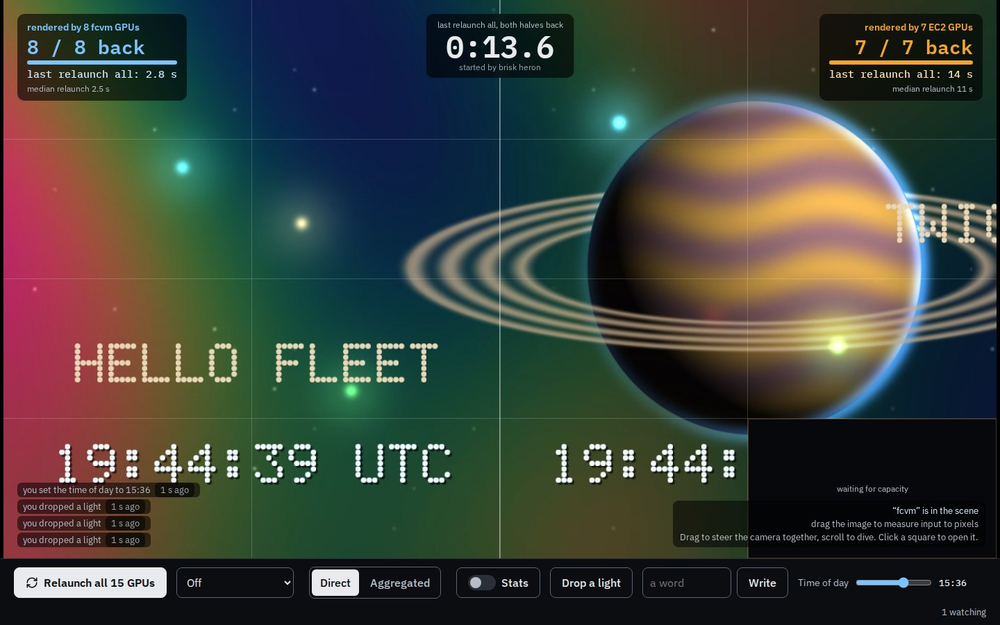

| | |
|---|---|
| 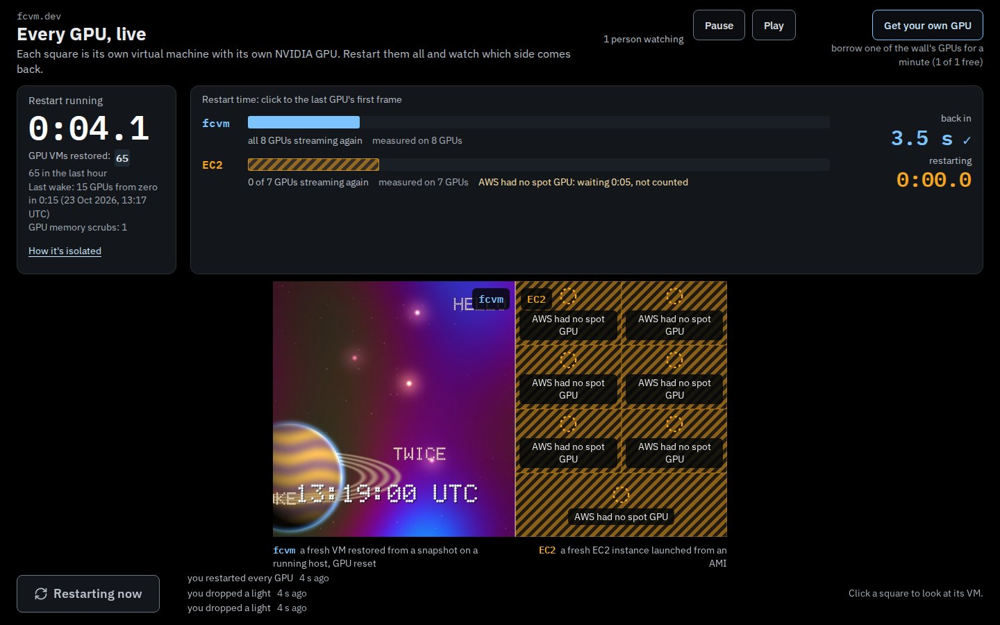 | 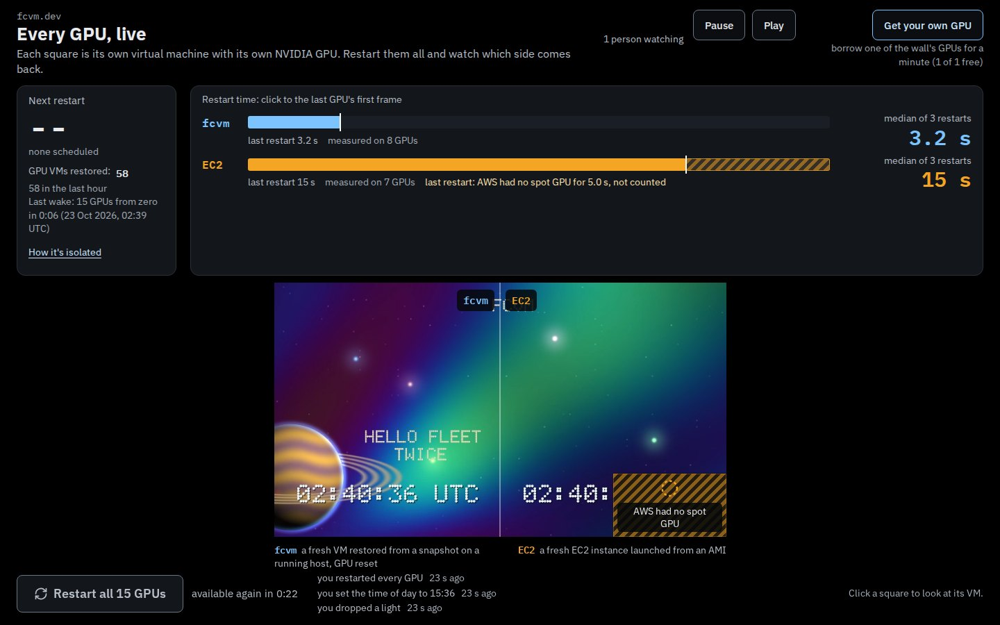 |
| 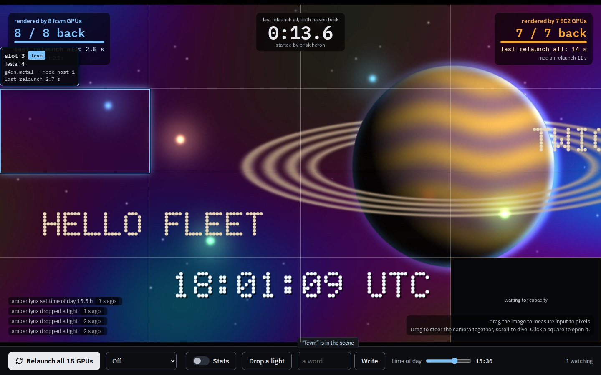 | 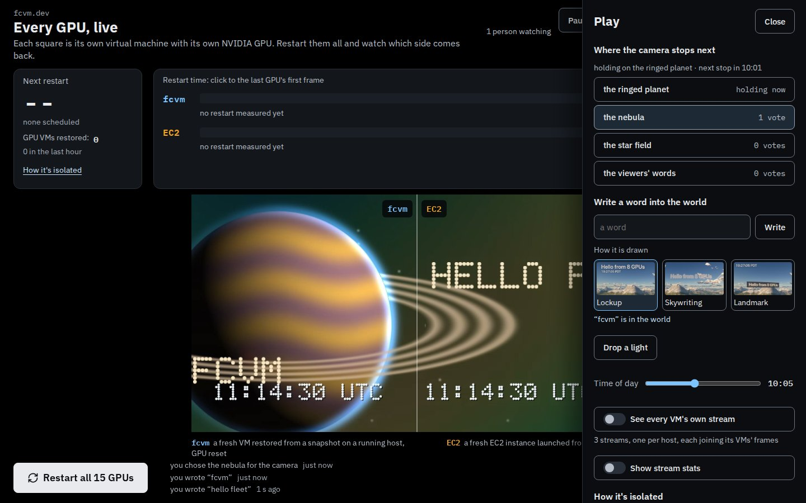 |
| 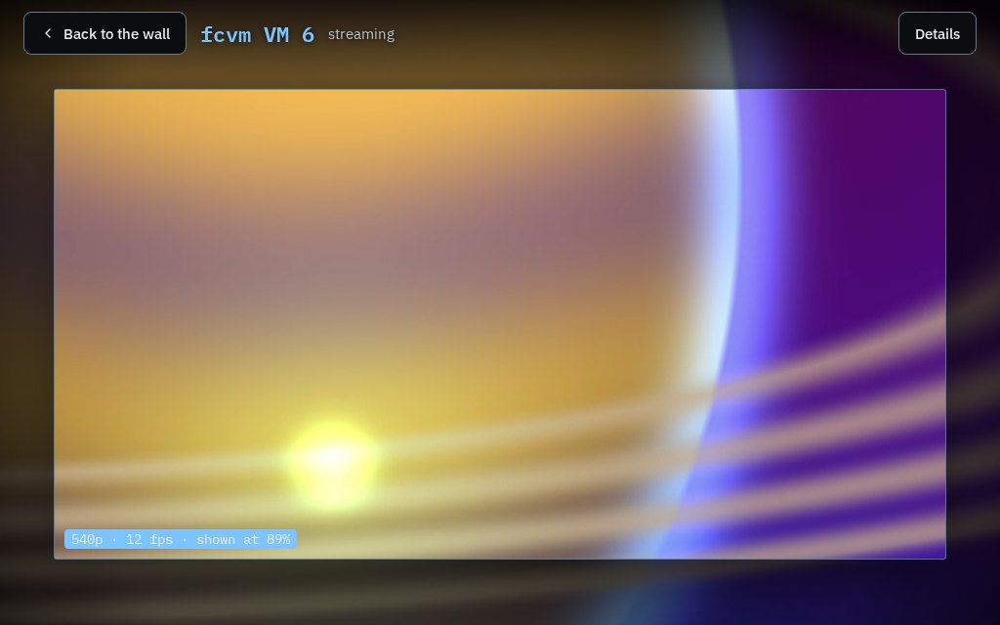 | 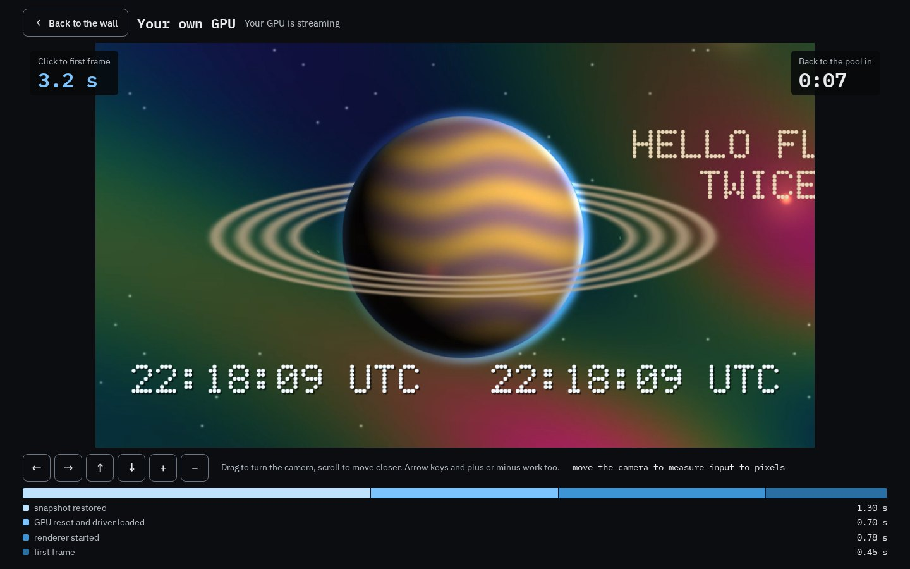 |
| 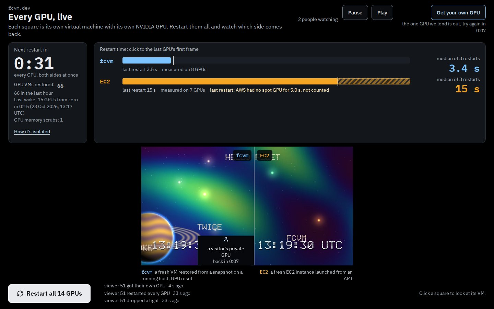 | 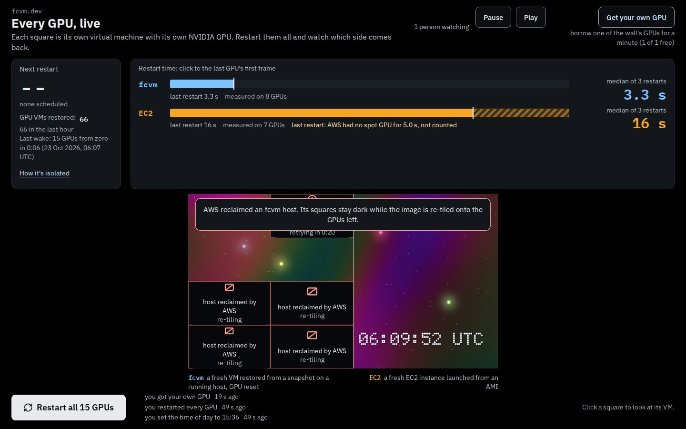 |
| 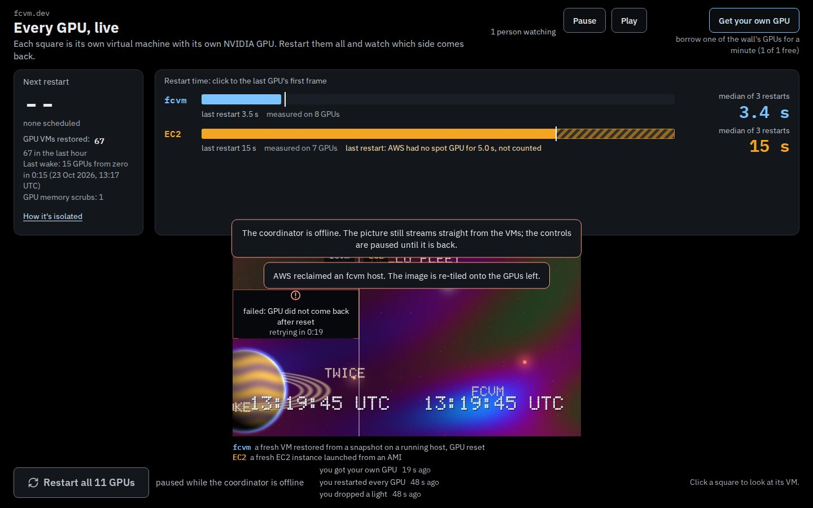 | 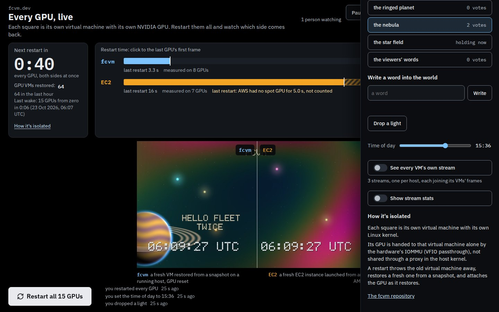 |
| 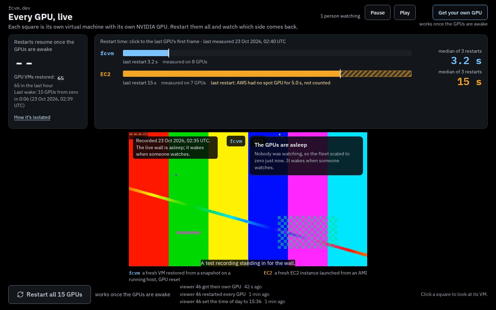 | 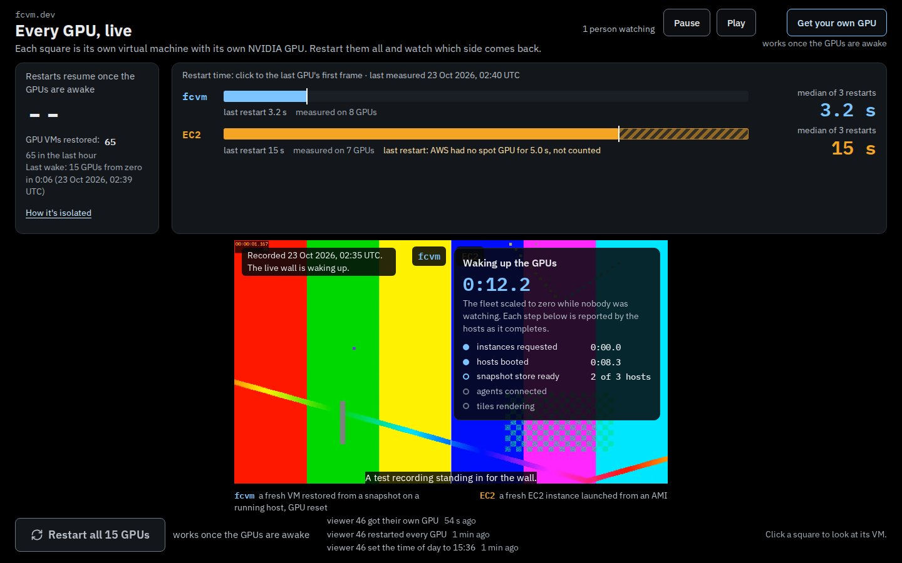 |

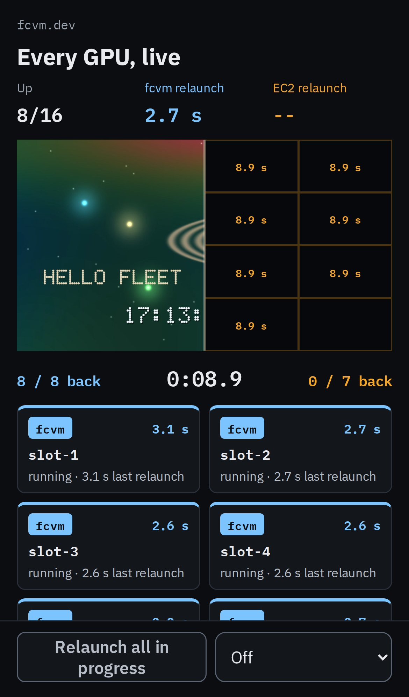

## Layout

```
core/      the rules, pure TypeScript: no DOM, no clock, no randomness, no I/O
           (lint and a tsconfig with no DOM types enforce it). Protocol parsing, the
           reducer, pending intents, clock sync, layout, the common-t choice, the
           race and scoreboard (race.ts), view models and every visible string.
app/       Next.js (App Router). Draws view models and sends actions:
           _wall/Wall.tsx           the stage, input handling, the hidden-tab rule
           _wall/Score.tsx          the countdown and the two bars
           _wall/PlayDrawer.tsx     the Play drawer
           _wall/OwnGpu.tsx         a viewer's own GPU, full screen
           _wall/FocusPanel.tsx     one VM opened
           _wall/Turnstile.tsx      the check before a viewer's first action
           _wall/frames.worker.ts   frame sockets, WebCodecs decoders, one OffscreenCanvas
           _wall/wall-client.ts     the coordinator socket and the store
           wall.css                 the surface's own stylesheet (no component library)
mock/      a mock coordinator and mock renderers, Node only
e2e/       Playwright tests against the mock (Chromium; a tagged subset in WebKit)
scripts/   dev-mock.ts (run the page on the mock), measure.ts (decode and draw cost),
           slow-link.ts (tiles after a race over a throttled link), coordinator-fixture.ts
           (the coordinator's snapshot states for the contract tests)
```

## Running it

Ports come from the environment or a gitignored `.env.ports`; nothing uses a framework
default. On a machine with the port registry, claim a block first
(`ports claim fcvm-fleet-web "$PWD"`) and write it down:

```
FLEET_WEB_PORT=<block+0>
FLEET_MOCK_COORD_PORT=<block+1>
FLEET_MOCK_RENDER_PORT=<block+2>
FLEET_TEST_BASE_PORT=<block+10>      # tests use it and the next two
FLEET_MEASURE_BASE_PORT=<block+15>   # measure.ts uses it and the next two
```

```
pnpm install
pnpm dev:mock         # the page on the mock fleet, next dev
pnpm build && pnpm start:mock    # the same with a production build
pnpm lint && pnpm typecheck && pnpm test     # 141 unit tests (vitest)
pnpm build && pnpm test:e2e                  # 39 browser tests (Playwright)
FLEET_SCREENSHOT_DIR=$PWD/docs/screenshots pnpm test:e2e   # also rewrites the pictures
pnpm build && pnpm measure [16 50 100]       # decode and draw cost
```

On a small machine, `FLEET_E2E_VIEW=960x600 FLEET_MOCK_FPS=10 FLEET_MOCK_THREADS=3`
makes the mock's work fit (CI uses these on a 4-vCPU runner). The mock needs `ffmpeg` with libx264 (`FLEET_FFMPEG` names another binary; CI uses the one in the `ffmpeg-static` package). Its knobs (`FLEET_MOCK_FCVM_GPUS`, `FLEET_MOCK_EC2_GPUS`, `FLEET_MOCK_FCVM_MS`,
`FLEET_MOCK_EC2_MS`, `FLEET_MOCK_RACE_EVERY_S`, `FLEET_MOCK_TURNSTILE`, ...) are listed at the top of `mock/main.ts`.
By default it restarts every GPU 20 s after start and every 5 minutes after that, holds
"restart now" for 60 s after each restart, and a quarter of races wait 10 to 30 s for EC2
spot capacity. fcvm restarts take 2.6 to 3.4 s (teardown, a restore holding a 0.6 s GPU
reset, renderer start, first frame) and EC2 35 to 70 s (launch, then boot to first
frame), shaped like the measured ones.
In production the page reads the coordinator's URL from `FLEET_COORD_URL` per request.

## How the page works

**The race is the hero.** The owner's schedule restarts every GPU on a cadence; the
countdown to the next one is shared by every viewer. "Restart all N GPUs" starts one now,
under a cooldown the coordinator sets for everyone; the button shows it ("available again
in 0:23"). During a race each half has one counter (tiles show a ring of their restart's
steps, not a clock of their own). fcvm's bar stops when its half is back while EC2's
grows; a wait for spot capacity is drawn hatched, first on EC2's bar, labelled "AWS had no
spot GPU", and left out of EC2's time. At rest the bars are each half's median, with a
mark at the last race and how many GPUs it was measured on. Every figure is the
coordinator's (`scoreboard`, `relaunch_all`, `last_relaunch`); the page computes no
timing of its own. When a half is back a polite live region says so in a sentence.

**What it has done.** Under the countdown, "GPU VMs restored: N" and how many in the last
hour, from the coordinator's `counters`; the number is highlighted each time it moves, so
a race or a borrowed GPU visibly adds to it. GPU memory scrubs are counted beside it once
the scrub has shipped.

**How it's isolated.** A link under the countdown opens the Play drawer at a short panel
in plain words: each square is its own virtual machine with its own Linux kernel; its GPU
is handed to that VM alone by the IOMMU (VFIO passthrough), not shared through a proxy in
the host kernel; a restart restores a fresh VM from a snapshot and attaches the GPU as it
restores; and, only when the snapshot's `security.gpu_scrub` is true, GPU memory is
cleared before a GPU moves to the next VM. Each sentence is what
`docs/fleet/ARCHITECTURE.md` describes (hosts with the IOMMU on and every GPU bound to
vfio-pci; `fcvm snapshot run --snapshot <gold> --gpu <sbdf>`; GPU attach as a restore
phase). One link goes to the fcvm repository; no other product is named.

**Scaled to zero.** With no visible viewer the fleet sleeps, and it wakes when one
arrives (`fleet.power`: asleep, waking, awake). The page tells the coordinator on every
visibilitychange, and on connect, whether its tab is visible (`{"type": "visibility",
"visible": bool}`), so hidden tabs do not count. Asleep or waking, the stage plays a
recording of the real wall (`/media/wall-reel.mp4`, `/media/wall-reel.webm` as the
alternative, captions from `/media/wall-reel.vtt`; muted, inline, looping) over the poster,
which shows until the video plays and stays if it cannot. With less motion asked for or
data saving on, the poster stays with a "Play the recording" button. A badge says when it
was recorded, from `/media/wall-reel.json`. Beside it, a card shows a live clock since the
wake began and each phase as every host reports it (instances requested, hosts booted,
snapshot store ready, agents connected, tiles rendering); there is no progress bar.
Restart and the own-GPU button say they work once the GPUs are awake, and the scores
keep their last numbers, labelled with the date they were measured. Once the fleet is
awake and every region of the live image has a frame, the recording fades out over it,
so nothing blank is ever shown. The wake, as measured, appears once under the counter:
"Last wake: 128 GPUs from zero in 2:07". The page reads the media from `FLEET_MEDIA_URL`
(default `/media` on its own origin, Workers static assets: a 720p reel stays well under
the 25 MiB per-file limit); the mock serves a generated 4 s test clip.

**Each side as wide as its GPUs, and re-tiling without a hitch.** The coordinator gives
every tile its rectangle, and the sides are as wide as the GPUs each has live (fcvm 100
against EC2 12 puts the line at 100/112); there are no places waiting for capacity. When
GPUs join or leave, the snapshot carries a new `layout.gen` and the frame (`at_frame`, on
the renderers' t = k/30) from which the renderers draw the new rectangles. The page opens
the new generation's streams at once and keeps drawing the old tiles, from frames before
`at_frame`, until every tile of the new generation has a frame at or after it; then it
swaps them all in one draw (after 4 s it swaps anyway, so a renderer that never answers
cannot hold the image). The seams, hover labels, keyboard grid and dark tiles follow the
tiling on screen, switching in the same moment; an opened VM and Aggregated mode take the
new rectangles. A frame is placed by the stream header it was encoded under, and a place
that moves to another GPU keeps its old stream until the swap. A side with no GPUs gives
the other the full width and says "EC2: no GPUs live right now" (or fcvm).

**Words on the stage.** One sentence under the title says what the page is, "fcvm" and
"EC2" sit on backplates either side of the seam, and one line under each half says what a
restart there is. Slots, relaunches and "8/8 back" are gone from the page: tiles are "fcvm
VM 3", restarts are restarts, and a half is "all 8 GPUs streaming again".

**First load.** The page paints the coordinator's `/poster.jpg` (the last whole image) in
the HTML, before any script runs. The canvas then draws the same poster under every
region without a frame yet and fades each tile in as its stream arrives; the page's own
copy goes once the canvas has painted.

**Failure states.** A VM that did not come back shows its error and when the coordinator
retries it. A host AWS reclaimed shows its tiles as reclaimed, with a banner, while the
image is re-tiled, then as places with no GPU. With the coordinator offline the streams
keep playing (they come from the VMs), a banner says so, and the controls are paused
until it is back. EC2 places with no instance are hatched "AWS had no spot GPU".

**Your own GPU.** "Get your own GPU" borrows one of the wall's fcvm GPUs. The page opens a
full-screen private view at once, timing from the click; the coordinator restores a VM on
that GPU and the timer stops at its first frame; a 60 s countdown runs from there. The
viewer has their own camera (drag, wheel, arrow keys, the buttons). On the wall, the
borrowed tile fades out to a backplate, "a visitor's private GPU, back in 0:42", and sits
out races. When the minute is up the view says so and returns to the wall, where the
viewer watches their tile restore back in. With every lendable GPU out the button says
so and when to try again.

**Turnstile.** When the coordinator's hello carries a site key, the first action waits for
a Turnstile check (in the Play drawer, or beside the button pressed), then goes. The
script loads only then.

**A hidden tab.** After `HIDDEN_PAUSE_MS` (5 minutes, `core/store.ts`) hidden, judged
from the visibilitychange time so a throttled timer still decides right, the page closes
every frame stream and stops decoding; the coordinator socket stays. Shown again, the
last picture stays up while the streams reopen, and the live image fades in over it once
every region has a frame at one t (the mode switch's rule, with its 4 s limit).

**Accessibility.** Text is 14 px or larger at 4.5:1 or better against what is behind it
(a test reads every visible text element), controls are at least 44 px, a Pause button
holds the picture, and with reduced motion asked for a tile going dark fades over 0.7 s
instead of flashing.

**Phone.** The image full width, the countdown and the two bars, one button, and in
portrait a hint to turn the phone.

**Two ways to receive the image.** Aggregated is the default: one stream per host,
each an aggregator's joined region, drawn as one big tile with crop and x0/y0 as usual.
"See every VM's own stream" in the Play drawer switches to Direct, one stream per tile
from its VM; when the browser reports a downlink under what Direct needs at the
renderer's rate, or more than 10% of tiles ran behind the common t, the drawer says so.
The choice is remembered in this browser. Tile state (dark tiles, outlines in the
half's colour, phases, clocks, hover outlines and labels) comes from the snapshot and is
drawn the same way in both modes: in Aggregated mode a relaunching tile's region is
painted dark over the aggregator's pixels.

**Switching never hitches.** The page keeps the shown mode's streams and opens the other
mode's in the background. While it waits, the drawn t does not advance past the newest
frame every incoming region holds (an aggregator joins tiles before it encodes, so it runs
a little behind), and never goes back. Once every incoming region holds a decoded frame at
one t no older than the one on screen, the next draw shows the new mode whole, and the old
streams close after it. After 4 s of waiting the image stops holding back for it and keeps
playing the old mode. A test records every draw across a switch both ways and fails on any
region drawn without a frame or any t going back.

**Two kinds of connection.** One WebSocket to the coordinator's `/live` for snapshots,
receipts and clock answers, and one per tile to its renderer for frames. The frame
sockets, decoders and the canvas live in a worker, so the React thread never sits
between a frame and the screen.

**Shared state.** Every intent carries a client UUID and is shown at once as pending
(a relaunched tile goes dark for its viewer before the coordinator answers, a setting
shows its new value). It stays pending until its receipt has arrived and a snapshot at
the receipt's version has been accepted, so the overlay never flickers back. Snapshots
older than the last accepted version are dropped. After a reconnect the page sends the
intents that have no receipt again, with the same ids; the coordinator applies an id
once and answers a repeat with the first receipt.

**Clock.** Pings go out five times quickly, then every 2 s. The offset comes from the
sample with the smallest round trip of the last eight. Race clocks, countdowns and frame
age all use the coordinator's time.

**One common t.** Each tile keeps up to 18 decoded frames. Every draw picks T and draws
each tile's frame at exactly T: the latest frame time every keeping-up tile holds, so the
image waits for the slowest of them; failing that, the picture holds while a keeping-up
tile catches up to it; failing that, the frame time the most keeping-up tiles hold (the
latest, on a tie). A tile keeps up while it is at most 0.35 s behind the newest, 0.55 s if
it was in step on the previous draw, so a decode that stalls for a moment holds the image
instead of flashing the tile dimmed and back. A tile that does not keep up, or whose frames the
others no longer hold, is drawn dimmed from its newest frame before T; a tile that just
joined stays dark until the image reaches its first frame; T never goes back. A decoder
holding more than eight undecoded chunks drops input until the next keyframe. Two different times are never drawn side by
side undimmed. Draws happen only when T or the plan changes, so the canvas redraws at
the renderers' rate, not the display's.

**Layout.** The image keeps the coordinator's `image_aspect` and is fitted inside the
space the page has. Tile edges are snapped to device pixels from the image's own edges,
so neighbours share an edge exactly. Each tile asks its renderer for the height it
occupies in device pixels, rounded up to one of 72, 90, 108, 144, 180, 216, 270, 360,
432, 540, 720 or 1080.

**Seams on demand.** With the pointer over the image every tile boundary fades in as a
1-device-pixel line at 25% white, and the tile under the pointer gets an outline in its
half's colour and a label (VM, kind, GPU, place, last restart). A line with nothing to
report says why: "waiting for EC2 capacity" while the tile is not up, "not reported" or
"not recorded" once it is. The place is `EC2 in <region>`, never the host name. A long press does the
same on a touch screen; keyboard users tab into a grid of the tiles and move with the
arrow keys. All of it is drawn by the page over the frames, never in them.

**An opened VM** fills the screen. The whole image zooms (420 ms, eased; at once with
reduced motion) until that tile fills the stage less a margin, and every other tile stays
where its rectangle of the image puts it, dimmed by a vignette (55% black next to it, 82% at
the far corners), so the scene runs on past its edges. Its stream asks for the height that
covers its box, up to the renderer's measured detail view (`DETAIL_TILE_PX`, 1080 x 1080 at
30 fps): 1080 for a square tile, 720 for a 16:9 one. A sheet over the picture holds the
timeline of its last restart as the coordinator measured it and its GPU's temperature,
power and load with two minutes of history: at the right on a wide screen (it folds away,
and the tile moves clear of it only when that costs no size), at the bottom on a phone,
where the tile is full width and the sheet starts folded to a handle. A click on a dimmed
tile, or an arrow key, opens that tile instead.

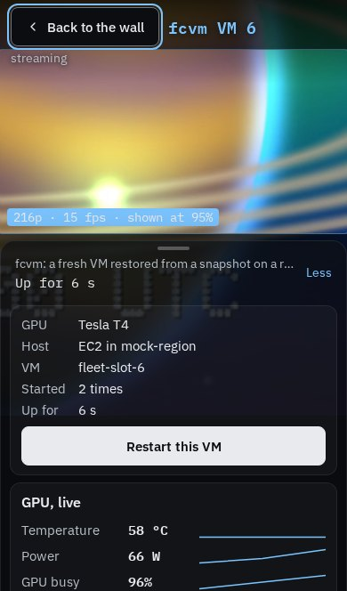 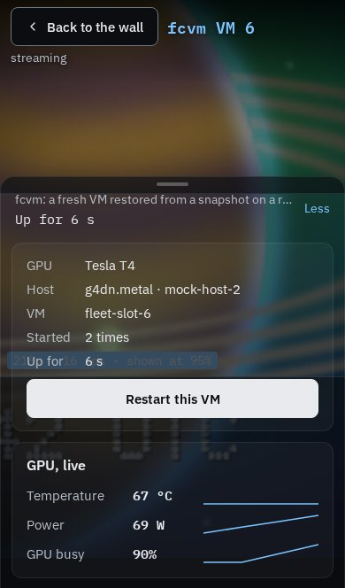

## Measurements

Decode and draw cost in Playwright's headless Chromium 156 on this development machine
(a 96-core Arm Neoverse-V2 server with no GPU, so decoding and canvas drawing are both
software). The mock renderers ran on the same machine. These numbers are indicative
only: a laptop or phone decodes in hardware and composites on its GPU. Mock streams are
30 frames per second, on the renderer's t = k/30 grid.

| tiles | viewport | stream height | decoded frames/s (of 30 x tiles) | draw per frame, p50 / p95 | display frame, p50 / p95 | incoming (mock) | at the renderer's rate | browser CPU | CPU per decoded frame |
|---|---|---|---|---|---|---|---|---|---|
| 16 | 1440x900 | 144 | 480 of 480 | 2.8 / 3.8 ms | 16.7 / 16.8 ms | 3.6 Mbit/s | 18.1 Mbit/s | 0.27 cores | 0.57 ms |
| 50 | 1440x900 | 164 | 1500 of 1500 | 4.9 / 6.4 ms | 16.7 / 16.8 ms | 7.9 Mbit/s | 39.8 Mbit/s | 0.59 cores | 0.39 ms |
| 100 | 1440x900 | 82 | 3000 of 3000 | 7.5 / 9.6 ms | 16.7 / 16.9 ms | 10.3 Mbit/s | 60.0 Mbit/s | 0.97 cores | 0.33 ms |

Direct mode, measured on this branch (the stage letterboxes the image between the race
and the button, so tiles cover fewer pixels than in the earlier full-window layout and ask
for shorter streams; the tallest stream is listed, which the encoder's 146 px minimum
width can raise above the twelve heights). Earlier, with the image filling the window,
the same machine measured 16 tiles at 216p in 5.9 / 8.0 ms a draw and 100 tiles at 90p
in 10.3 / 12.6 ms, and at 2560x1440 the software canvas became the limit (19.5 / 21.6 ms
a draw at 100 tiles).

Command: `FLEET_MOCK_THREADS=40 node scripts/measure.ts 16 50 100` (8 s warm-up, 15 s
measured), with the machine's load average at 11 to 13 from other work. "Incoming (mock)" is
what the page received from the mock's libx264 at constant quality; "at the renderer's
rate" is what the same streams cost from the real renderer, which encodes at a constant
0.8 bits per delivered pixel (overlap included) at 30 fps, at least 0.6 Mbit/s each
(`core/bandwidth.ts`). Every run held all tiles at one t with none behind, and decode
latency stayed under 1 ms at p95. Draw time follows the pixels drawn, more than the
number of tiles. In the default Aggregated mode a viewer decodes one stream per host
instead of one per tile. On this evidence 100 tiles fit one browser's decoding budget; the
measurement in `docs/fleet/ARCHITECTURE.md` (a laptop and a phone, with GPU compositing,
Chrome and Safari) should set `max_tiles`.

**Bandwidth.** Each tile asks for the device pixels it covers, rounded up to the next of
the twelve heights. In Direct mode the page then keeps the streams within 80 Mbit/s at the
renderer's rate: while the sum is over, the smallest tile still at the default quality
asks for `q=lo` (small tiles lose least on screen), and once every tile is at `lo` the
tallest stream steps down one height. `?budget=<Mbit/s>` sets another budget for trying it.
The page models `lo` as half the default rate and floor, and `hi` as double; the renderer
has not documented its figures yet. With a tile
opened, the tiles still on screen around it keep their wall height at `q=lo` (they are
dimmed), the ones the zoom pushed off screen keep streaming at the smallest height (72) so
closing it is instant, and the opened tile asks for its detail height and is kept out of the
budget's steps. The floor of 0.6 Mbit/s a
stream sets the cost of a large wall: 100 tiles cost 60 Mbit/s at any height, so a
fleet that wants 100 tiles on ordinary connections needs a lower floor or fewer tiles
per viewer. The stats switch shows the current total.

**Safari.** According to WebKit's release notes, WebCodecs `VideoDecoder` shipped in Safari 16.4 (macOS and iOS), with H.264
among its codecs, as did `OffscreenCanvas` with a 2D context. Playwright's WebKit build
(WebKit 27.2 on Linux, not Apple's Safari) reports H.264 decoding supported, and it runs
the mosaic, seam and hover tests here (the `@engines` tests). If a worker has no
`requestAnimationFrame`, the page ticks it from the main thread. Apple's Safari itself is
not tested by this PR.

**Tiles coming back after a race, over a slow link.** `node scripts/slow-link.ts <mode>
<clean|slow>` puts a TCP proxy in front of the mock coordinator and renderers (connection
setup time, one-way delay, one bandwidth cap shared by every connection, TCP backpressure
kept), presses restart, samples each tile on the canvas every 100 ms, and reports when it
showed a frame against the coordinator's `first_frame_at` for it. 15 tiles, fcvm restarts
of about 5 s, EC2 about 12 s, 1440x900, Chromium on this development machine:

| mode | link | shown after the coordinator says running |
|---|---|---|
| aggregated | none | p50 119 to 163 ms, max 227 ms |
| aggregated | 100 ms RTT, 400 ms setup, 16 Mbit/s | p50 199 to 219 ms, max 318 ms |
| aggregated | the same at 4 Mbit/s | p50 229 ms, max 292 ms |
| direct | none | p50 215 to 221 ms, max 761 ms |
| direct | 100 ms RTT, 400 ms setup, 16 Mbit/s | p50 928 to 974 ms, max 3.4 s |
| direct | the same at 4 Mbit/s | p50 1.0 s, max 3.5 s |
| direct | 100 ms RTT, 1200 ms setup, 16 Mbit/s | p50 8.1 s, max 9.8 s |

The link queue peaked at 22 ms (16 Mbit/s) and 111 ms (4 Mbit/s): bandwidth is not what
delays the direct tiles. In direct mode a restarted tile is a new renderer process, so
the page opens a new socket for it once the coordinator says it runs, and opens them all
at once. The browser connects to one IP and port one WebSocket at a time (RFC 6455,
section 4.1), and the proxy, like a single forwarded port, is one address: the
renderers' connections started exactly one setup time apart (510 to 513 ms at 400 ms
setup, 1310 to 1320 ms at 1200 ms), so the eighth tile of a race waits for seven
setups. Aggregated mode, the default, keeps one stream per host open through a race and
showed every tile within 0.32 s. Over a tunnel with slow connection setup, give each
renderer its own forwarded address or use aggregated mode.

## Interface notes

The page and the mock follow `fleet/PROTOCOL.md` as the coordinator (#1146) and renderer
(#1144) PRs write it: tiles are places (`fcvm:3`) with their slot beside them, the
snapshot carries `image_aspect` and `aggregates: [{id, half, host, rect, frame_url,
tiles}]`, the first message is `{"type": "hello", "viewer": "v-17"}`, actions are `{at,
viewer, id, name, args, summary, outcome}`, `gpu` is `{sbdf, name}` with readings in
`gpu_stats`, timings are `<part>_ms`, receipts are `committed` or `refused`, the clock
answer echoes `client_unix_ms`, snapshots may skip versions, frames fall on `t = k/30`,
the stream header carries `full_width`, `full_height`, `x0`, `y0`, `fps` and `crop`, the
stream may be larger than asked, and `{"h": N}` brings a new header and a keyframe. The
page draws only a stream's inner rectangle, placed at `x0, y0` of the full grid (also for an
opened VM, whose zoomed image is larger than the screen), by drawing the whole frame scaled and clipped, because WebKit ignores a
VideoFrame's source rectangle and `visibleRect`.

**The coordinator's names, held by a test.** `core/test/contract.test.ts` parses the
coordinator's own snapshot states: the `final_view` of each of the 24 vectors in #1146's
`fleet/core/tests/vectors`, copied into `core/test/fixtures/coordinator.json` by
`node scripts/coordinator-fixture.ts <vectors dir> <commit>`. It fails when a field the
page keeps is missing from them or holds another value, and when the page sends an
intent the coordinator does not know. `mock/test/mock.test.ts` holds every snapshot the
mock sent during its suite to the same shapes, apart from a short list PROTOCOL.md
documents that no vector ends with (a borrowed tile's `borrowed`, `gpu_stats`, the
agent's `ack_ms` and `total_ms`) and the mock pattern's flat camera (`x`, `y`, `zoom`).

What the end-to-end run against #1146 changed:

- `layout.generation` and `layout.from_frame` (were `gen`, `at_frame`).
- `counters.restores` and `counters.scrubs` (were `restores_total`, `scrubs_total`).
  There is no `security` field: the page speaks of the GPU memory scrub once
  `counters.scrubs` is above zero.
- The race button sends `restart_now` (was `relaunch_all`; the race is still the
  snapshot's `relaunch_all`). A scheduled race is not an intent and so not in `actions`:
  the feed's "the scheduled restart of every GPU began" comes from `relaunch_all.by`.
- There is no `time_of_day` intent (each hold's viewpoint sets it), so the drawer has no
  time-of-day slider.
- A reclaimed host's tiles leave the tiling in the same event; there is no tile-level
  `host_reclaimed` and no `draining` phase. The banner reads `failures` (`host_reclaimed`,
  kept a minute) and `fleet.hosts[].draining`.
- "N people watching" is `viewers.active` (visible tabs); `viewers.count` counts
  connections.
- Asleep, nothing is placed: `tiles` and `aggregates` are empty. EC2 tiles report
  `starting` with `launch_ms` and `ready_ms`.
- `word {text, text_style}`: `lockup` (the default), `skywriting` or `landmark`, per
  message, as both #1146 and the renderer (#1178, "Words, the clock and lights") define it.

Still this page's own: `/media/wall-reel.json: {recorded_at, duration_s, measured: {gpus,
fcvm_ms, ec2_ms} | null}`.

The wall no longer sends camera drags or `set_auto_relaunch`: the camera is directed,
with nudges, and the owner's cadence replaces the viewer setting. A dropped light is
`{"pos": [x, altitude, z], "color": [r, g, b]}`, 2 km along the ray through the clicked
pixel on the camera at the drawn t. Input-to-pixel latency is measured on a viewer's own
GPU, from a drag to the first draw at or past the claim's camera key tagged with that
intent. The renderer's `q=hi|std|lo` goes on the frame URL only when it is not `std`.

The mock encodes H.264 baseline with libx264 (`q` as constant quality 14, 18 or 26)
rather than High with NVENC, lays each side out in proportion to its GPUs (the fcvm side
in one full-width band per host, `FLEET_MOCK_FCVM_GPUS`, `FLEET_MOCK_EC2_GPUS`, and
`/mock/fault {fcvm_gpus, ec2_gpus}` to re-tile), runs one aggregator per fcvm host and one for the EC2 side
(each draws its region whole and blacks out tiles that are not running), draws the UTC
clock once in each half, renders a viewer's own GPU as the whole image from its own
camera, and shows `relaunching` for 150 ms before a tile's first reported phase.

## Not done here

- Deploying: the Cloudflare Workers build (OpenNext) and the staging Worker behind Access.
  The client bundle uses no Node APIs; the server page reads one environment variable.
- Running against the real coordinator and renderers, and the interface decisions above.
- The `max_tiles` measurement on a laptop and a phone in Chrome and Safari.
